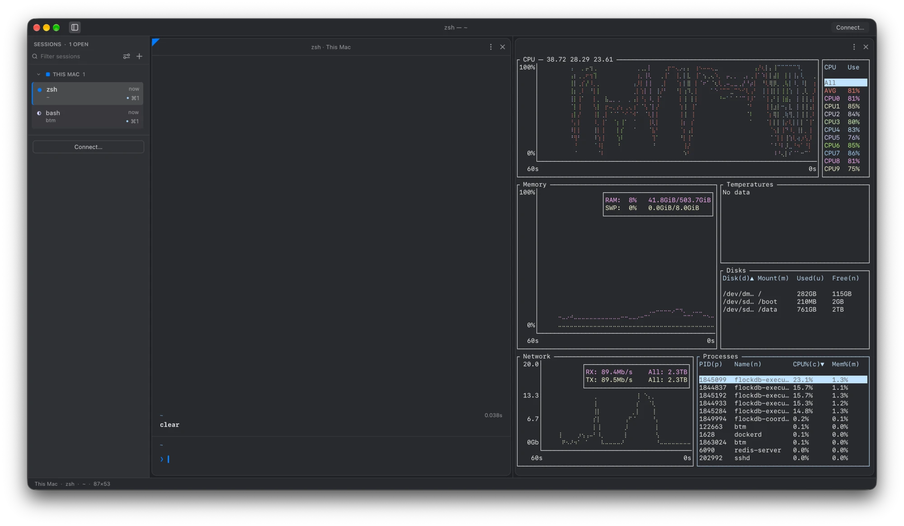

# Swarm

A macOS terminal with persistent sessions. Every tab is a session owned by a
small background daemon, `swarmd`, on your Mac or on a Linux or macOS server
over SSH. Close the window, quit the app, lose Wi-Fi or update Swarm: your
shells, builds and servers keep running, and the tabs reattach with their
output.



**Download:** [swarm-term.com](https://swarm-term.com) or
[Releases](https://github.com/arturborycki/swarm-term/releases). macOS 13
Ventura or later, universal (Apple silicon and Intel), signed and notarized
by Apple. Swarm installs its own updates, and can download and install them
in the background (Settings → About). Or with Homebrew:

```bash
brew install --cask arturborycki/swarm/swarm
```

- **Persistent tabs:** sessions belong to `swarmd`, not to the app, so they
  survive the app quitting, crashing or updating.
- **AI coding agents keep working:** Claude Code, Codex and other agents
  started in a tab keep running when you close it or quit the app; on a
  server they also keep going while your Mac sleeps.
- **Local or remote:** sessions run on this Mac or on Linux and macOS hosts
  through your own ssh setup. The app installs `swarmd` on a host itself and
  reconnects after sleep or network drops.
- **See what needs you:** programs report working, blocked, done or failed,
  and Swarm shows it on the session, notifies you and badges the Dock icon.
  Go to Anything (⌘P) jumps to the session that is waiting, and the Activity
  view (⌘.) lists only sessions with something to report.
- **Find in every session:** Find in All Sessions (⇧⌘F) searches the output
  of all your sessions, on this Mac and connected hosts, detached ones and
  output kept on disk included, and opens the one you pick at the match.
- **tmux keys if you want them:** turn on Ctrl-B (or Ctrl-A) prefix keys in
  Settings → Keyboard Shortcuts to split, move between, zoom and resize panes
  as in tmux.
- **Open what your sessions serve:** a dev server in a session shows up in Go
  to Anything as "Open localhost:3000"; on a remote host Swarm forwards the
  port over ssh first.
- **Splits and groups:** sessions sit in sidebar groups (This Mac, one per
  host, your own); drag any session onto a pane to show local and remote
  sessions side by side.
- **A modern terminal on top:** the app is built on Warp's open-source engine
  (blocks, the input editor, completions), with its own design and no Warp
  account.
- **Updates without restarts:** a new `swarm-shim` takes over running sessions
  in place.
- **Scrollback:** 16 MB per session in memory, optionally more on disk,
  encrypted with a key only that session holds.
- **`swarmctl`:** list, start, attach to, rename, dump and end sessions, on
  this Mac or with `--host`; send keys, capture the screen and wait for
  programs from scripts and agents.

Docs: [swarm-term.com/docs](https://swarm-term.com/docs/). Design notes:
[docs/DESIGN.md](docs/DESIGN.md).

## What's here

| Path | What it is |
|---|---|
| `crates/swarm-proto` | Wire protocol, framing, shared paths |
| `crates/swarm-shim` | Per-session process: PTY, child, scrollback, replay |
| `crates/swarmd` | The daemon (`swarmd`) and the shim binary (`swarm-shim`) |
| `crates/swarm-client` | Async client library (local socket or `ssh host swarmd bridge`), also used by the app |
| `crates/swarmctl` | Command-line client |
| `app/` (not in this repository) | The app: a fork of Warp, [arturborycki/swarm-app](https://github.com/arturborycki/swarm-app), checked out here |
| `scripts/` | App bundle, Linux builds, DMG, signing and icon scripts |
| `site/` | swarm-term.com (Astro, deployed on Cloudflare) |
| `packaging/homebrew/` | Homebrew cask and formula, copied to the [tap](https://github.com/arturborycki/homebrew-swarm) on each release |

## Build the daemon and swarmctl

```bash
cargo build --release
```

```bash
./target/release/swarmctl new --name work
```

Inside the session, press Ctrl-\ to detach. Then:

```bash
./target/release/swarmctl ls
```

```bash
./target/release/swarmctl attach work
```

Other commands: `swarmctl rename`, `kill`, `rm`, `info`, `meta`, `dump`,
`daemon status|stop|upgrade-shims`. For scripts and agents, `send`,
`send-key`, `capture` and `wait` drive a session without attaching to it
(`-s <session>`, or the session they run in), and `--json` prints JSON.
`swarmctl status` shows what programs report about themselves (the
Program Status Protocol, OSC 7501, plus bells, notifications and progress), `wait --until blocked,done`
waits for a program to need you, and `swarmctl events` streams changes. `swarmctl agents install`
has Claude Code and Codex report their state through hooks. `swarmctl ports` lists the
ports programs in sessions listen on, such as a dev server, and `swarmctl grep <text>` finds text in
every session's output. The daemon starts on first use;
`swarmd stop` stops it without ending any session.

To start the daemon at login instead (launchd agent on macOS, systemd user unit
on Linux, which also turns on lingering so sessions survive logout):

```bash
./target/release/swarmctl daemon install-service
```

`daemon uninstall-service` goes back to starting it on demand; `daemon
service-status` shows the current mode.

### Remote hosts

Add `--host <ssh-host>` to any command to use the daemon on that machine
through your own ssh setup (keys, agent, `~/.ssh/config`). The host needs
`swarmd` and `swarm-shim` in `~/.local/share/swarm/bin/` (or `swarmd` on
`PATH`). The app installs them when it connects; to install them by hand, see
[Install on a server yourself](https://swarm-term.com/docs/#server-install).

```bash
./target/release/swarmctl --host devbox new --name build
```

## Build the app

The app's source is the Warp fork in
[arturborycki/swarm-app](https://github.com/arturborycki/swarm-app)
(AGPL-3.0). It builds inside this repository, because it uses
`crates/swarm-client`:

```bash
git clone -b swarm https://github.com/arturborycki/swarm-app.git app
```

You need Xcode, rustup (the fork pins its Rust version in
`app/rust-toolchain.toml`) and `cargo install cargo-bundle`. Then:

```bash
scripts/bundle-app.sh
```

That prints the path of a debug `Swarm.app`. `--release` builds an optimized
one, and `--universal` builds for both CPUs. Linux builds of the daemon, which
the app installs on Linux hosts, come from `scripts/build-linux.sh`.
`scripts/make-dmg.sh` packages a release; its header describes signing and
notarization.

## Tests

```bash
cargo test --workspace
```

The end-to-end tests in `crates/swarmd/tests/e2e.rs` start real daemons, shims
and shells. `scripts/interactive-check.exp` drives `swarmctl` with vim and htop
in a real pty:

```bash
cargo build && rm -rf /tmp/swx && mkdir -p /tmp/swx && expect scripts/interactive-check.exp $PWD/target/debug
```

## Issues and security

Report a bug in [Issues](https://github.com/arturborycki/swarm-term/issues) or
with the form at [swarm-term.com/report](https://swarm-term.com/report/). For
security problems, see [SECURITY.md](SECURITY.md).

## License

Everything in this repository (the daemon crates, `swarmctl`, the scripts and
the site) is licensed under either of [MIT](LICENSE-MIT) or
[Apache-2.0](LICENSE-APACHE), at your option. The app in
[swarm-app](https://github.com/arturborycki/swarm-app) follows Warp's
licensing: AGPL-3.0, with some components under MIT (see its `LICENSE-AGPL`
and `LICENSE-MIT`).

Unless you explicitly state otherwise, any contribution you intentionally
submit for inclusion in this repository shall be dual licensed as above,
without any additional terms or conditions.
